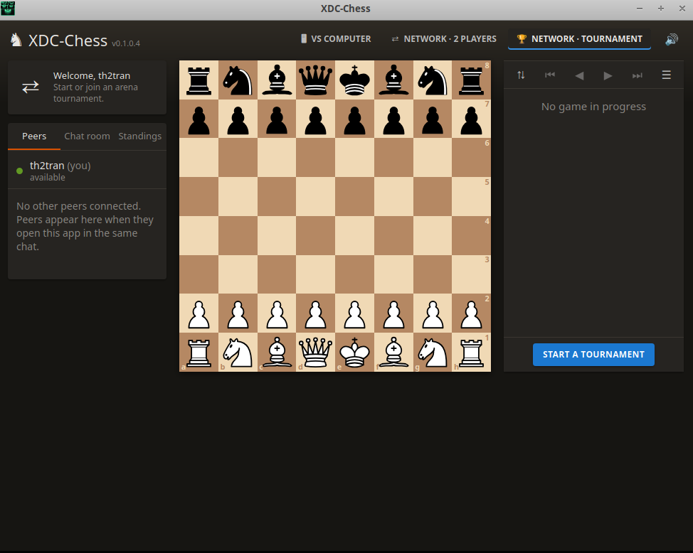
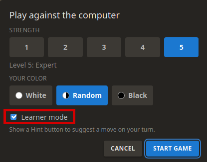

# Chess for Web-XDC

A chess game for [webxdc](https://webxdc.org) messengers such as Vector Chat, with a lichess-style layout.



## Play modes

- **vs Computer** – five strength levels (Beginner → Expert). The engine runs in a Web Worker. If workers are unavailable, a reduced-strength search yields between candidates to keep the interface responsive, with a warning shown in the app. Games are saved locally and support takeback.
- **Network · 2 players** – the **Peers** tab lists everyone who currently has the app open in the chat. Click a peer to challenge them (choose White, Black or random). If they accept, both of you enter a 5+0 game (5 minutes per side). Draw offers, resignation, rematch and spectating ("Watch") are supported.
- **Network · Tournament** – any peer that is not in a game or tournament can start a 60-minute arena tournament. Connected peers get an invitation; those who accept are added to the roster, which is kept in sync on every device (see **Standings**). Games are 5+0 and players are paired automatically after each game (win 2 points, draw 1, doubled after two wins in a row 🔥). No new games start after 60 minutes; the tournament ends once running games finish.

### Learner mode


Check **Learner mode** in **Play against the computer** to show a **Hint** button alongside Takeback and Resign. On your turn, click it for a suggestion, drawn as a blue arrow directly on the board without playing the move. In a webxdc host, Hint broadcasts the current FEN, starting FEN and UCI move history to the chat's XDC instance, asking the `Mero.xdc` **chess-coach** skill for a Stockfish WASM suggestion. The bot must be running in the same Vector community channel with its Iroh sidecar built, and the app must be open and connected. The request is also sent as a status update for hosts supporting that channel; Vector's bot currently communicates over realtime Iroh gossip, not durable status-update history. Clicking Hint therefore shares this computer-game position with the XDC instance's peers; normal computer moves remain local.

The button shows **Finding hint…** while waiting (up to 30 seconds). If the coach does not respond, the app announces the fallback, stops broadcasting, and uses its separate local Expert-level AI worker for the same position. Late coach replies are ignored once local analysis starts. Explicit coach errors and invalid replies still show a warning rather than triggering the timeout fallback. Requests are retried over realtime to tolerate bot discovery delays. Replies must match the requesting player, request ID, game ID and exact FEN, and the move must be legal. The arrow follows board orientation; promotion hints also show the promoted piece's letter at the destination. An accessible label describes the move for screen readers. The suggestion clears when the position changes or you navigate into move history, which also cancels pending requests and local analysis. Hints are unavailable during the computer's turn, while reviewing history, or after the game ends. When running outside a webxdc host, hints use the local Expert-level Web Worker immediately; worker failures show a warning. Neither path changes your selected opponent strength. Suggestions are the engine's best move within its search limit, not a guarantee of perfect play.

### Chess-coach XDC protocol

When a learner-mode computer game starts, the app sends a lightweight
`coach-probe` with a `requestId`. A connected coach replies with
`coach-available`, echoing the ID and addressing `to` to the player. A fresh
reply within 10 seconds triggers a one-time toast: **Chess Coach is available
and can provide a suggestion when you request HINT.** This checks the live
coach service without starting a Stockfish search. No toast is shown for absent
coaches, non-learner games, historical replies or replies for another game start.

Messages use the existing `chess-xdc/1` envelope (`app`, unique `id`, `from`, `name`, `ts` in milliseconds). A `hint-request` contains `requestId`, `gameId`, `fen`, `startFen` and `moves` (UCI strings). A `hint-response` echoes `requestId`, `gameId`, `fen`, adds `to` (the request's `from`), and contains either `uci` or `error`. Retries retain the same request ID. Responses only suggest a move; they never apply it. These application-level addresses correlate replies but do not authenticate the coach on the realtime channel.

The checkbox preference is remembered, and learner mode is retained when a saved computer game is reopened. It is off by default and never enabled for network games, tournaments, or imported PGN reviews.

## How networking works

- Messages go over the webxdc realtime channel (`joinRealtimeChannel`) for presence and fast delivery, and important events (challenges, game starts, moves, results, tournament state) are also sent with `sendUpdate` so they survive restarts and reach peers without realtime support.
- When the app is reopened, it replays the stored updates and resumes any unfinished game.
- **Chat room** keeps the most recent 100 messages in local storage across app restarts, merging replayed messages without duplicates. Each message shows its original date and time in your device's local format and time zone. Clearing the app's local storage removes this cache; messenger history is unaffected.
- The tournament creator's device coordinates the tournament: it pairs players, records results and broadcasts the roster/standings. If it goes offline, the online participant with the lowest address takes over.
- Clocks: live moves deduct locally observed elapsed time from the mover only; a received clock cannot overwrite the other player's time. Historical replay and sync restore only bounded, non-increasing mover snapshots. Network delays can cause small clock differences between devices. A player who runs out of time loses (or draws if the opponent cannot mate). If the opponent's device goes silent, the other side claims the win on time after a short grace period.
- Missing moves are buffered with a bounded gap, and sync requests are retried and persisted for offline delivery. Sync histories must match the known prefix and contain legal moves; a remote sync cannot invent this device's own moves. Play and timeout adjudication wait while a known move gap is unresolved. Recovery still requires a player with the missing history to reconnect; the app cannot reconstruct moves nobody can supply.
- Only the appropriate player can send a move, resignation, or draw response. Game starts must match a challenge or come from the tournament host. Tournament state must come from its declared host; live host changes must match the lowest-addressed online, non-withdrawn participant when the previous host is offline. Historical replay checks successor membership, but cannot reconstruct past realtime presence.
- **Trust model:** webxdc payload addresses are self-declared, not authenticated sender identities. These checks prevent spectators acting under their own addresses, but cannot prevent address impersonation, a dishonest tournament host, or forged historical timing. Play with trusted chat participants; this is not a cheat-proof competition protocol.
- The tab retains the latest 100 completed game records, plus the displayed game and all unfinished games. Older records are no longer available in the in-app crosstable or for PGN export. Expired challenges and silently disconnected peers are also removed from memory; persisted messenger history is unaffected.

## Importing a PGN from chat

Open **Menu → Import PGN**, paste one exported game copied from chat, and select **Import game**. The imported game opens locally in read-only review mode: click moves or use the navigation arrows to replay the board, flip it, or use **Copy PGN** to export it again. Names, result, and PGN headers are retained. Imported games are not broadcast, do not affect tournament scores, and are available until closed or the app is reloaded. Saved computer games are not overwritten.

Select **Play from here** in the imported-game panel to start a computer game from the currently displayed position. Choose the computer's strength in the setup dialog; you take the side to move and always move first. The new game replaces your locally saved computer game and retains its starting position when reopened. Positions already ended by checkmate or a draw cannot be continued; navigate to an earlier position instead.

The importer accepts SAN moves, optional move numbers, comments, annotations, and variations (only the main line is imported). It also accepts a surrounding Markdown code block and the clipped first `Event` header sometimes produced when selecting text in chat. Custom starting positions are supported with `[SetUp "1"]` and a `[FEN "..."]` header, including puzzle positions with no moves and just `*` as the movetext. A FEN header without SetUp is also accepted. The starting position, side to move, and move numbering are preserved for review and export. Illegal moves, malformed headers or FEN positions, conflicting results, and multiple games are rejected with an error so you can correct the pasted text. Finish any active network game before importing.

## Development

Requires Node.js. Sources are TypeScript (`src/`, bundled with esbuild) and SCSS (`src/styles/`, compiled with sass).

```sh
npm install
npm start          # build assets and run the webxdc-dev simulator (multiple instances)
npm test           # unit tests (rules engine/perft, AI, tournament logic)
npm run typecheck  # tsc
npm run build      # typecheck + tests + bump build number + bundle + package dist/chess-<version>.xdc
```

`npm run build` increments the build number in `package.json`/`package-lock.json` and synchronizes `version.js` and `manifest.toml`. Generated JavaScript and CSS go in `assets/`; the packaged archive goes in `dist/`.

## Credits

Piece graphics are based on the "cburnett" chess pieces by Colin M.L. Burnett (BSD/GPL/GFDL licensed).
